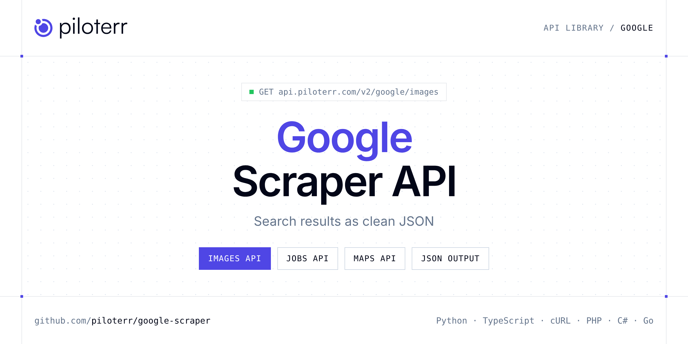

<p align="center">
  <a href="https://www.piloterr.com"></a>
</p>

# Google Scraper API

[](https://discord.gg/CFj3ph8aHU) [](https://app.piloterr.com) [](https://app.piloterr.com/openapi) [](LICENSE)

The **Piloterr Google Scraper API** lets you extract public data from Google as **clean, structured JSON** — no proxies, headless browsers or HTML parsing to maintain. Endpoints available in production:

- **Google Images API** — Google Images Scraper API – bringing the power of visual search to your fingertips.
- **Google Jobs API** — Extract job listings from Google Careers for enhanced recruitment and market analysis.
- **Google Maps API** — Extract comprehensive company data from Google Maps for enhanced business insights.
- **Google Search API** — Scrape real-time Google search results with organic listings, knowledge graph, related searches, and advanced filters.
- **Google AI Mode API** — Scrape real-time Google AI Mode answers: text_blocks, references, and shopping_results.
- **Google Search Autocomplete API** — Retrieve real-time Google Search autocomplete suggestions for any query, with support for language and country localization.
- **Google Shopping API** — Search Google Shopping and retrieve structured product listings with prices, ratings, merchants, and product IDs.
- **Google Videos API** — Scrape video results from Google Videos search including YouTube, Reddit, and other video platforms, with location and language support.

Use it for SEO rank tracking, SERP monitoring, ad intelligence, market research or grounding LLM answers with fresh search results.

| Endpoint | Path | Credits | What you get |
|---|---|---|---|
| [Google Images API](#google-images-api) | `/v2/google/images` | 1 | Google Images Scraper API – bringing the power of visual search to your fingertips. |
| [Google Jobs API](#google-jobs-api) | `/v2/google/jobs` | 1 | Extract job listings from Google Careers for enhanced recruitment and market analysis. |
| [Google Maps API](#google-maps-api) | `/v2/google/maps` | 3 | Extract comprehensive company data from Google Maps for enhanced business insights. |
| [Google Search API](#google-search-api) | `/v2/google/search` | 1 | Scrape real-time Google search results with organic listings, knowledge graph, related searches, and advanced filters. |
| [Google AI Mode API](#google-ai-mode-api) | `/v2/google/search/ai` | 3 | Scrape real-time Google AI Mode answers |
| [Google Search Autocomplete API](#google-search-autocomplete-api) | `/v2/google/search/autocomplete` | 1 | Retrieve real-time Google Search autocomplete suggestions for any query, with support for language and country localization. |
| [Google Shopping API](#google-shopping-api) | `/v2/google/shopping` | 1 | Search Google Shopping and retrieve structured product listings with prices, ratings, merchants, and product IDs. |
| [Google Videos API](#google-videos-api) | `/v2/google/videos` | 1 | Scrape video results from Google Videos search including YouTube, Reddit, and other video platforms, with location and language support. |

## Table of contents

- [How it works](#how-it-works)
- [Google Images API](#google-images-api)
- [Google Jobs API](#google-jobs-api)
- [Google Maps API](#google-maps-api)
- [Google Search API](#google-search-api)
- [Google AI Mode API](#google-ai-mode-api)
- [Google Search Autocomplete API](#google-search-autocomplete-api)
- [Google Shopping API](#google-shopping-api)
- [Google Videos API](#google-videos-api)
- [Code examples in other languages](#code-examples-in-other-languages)
- [Practical use cases](#practical-use-cases)
- [Why Piloterr?](#why-piloterr)
- [FAQ](#faq)
- [Related scrapers](#related-scrapers)
- [Support](#support)

## How it works

1. **Create a free Piloterr account** and copy your API key from the [dashboard](https://app.piloterr.com).
2. **Send a `GET` (or `POST`) request** to `https://api.piloterr.com/v2/...` with the header `x-api-key: YOUR_API_KEY`.
3. **Receive structured JSON** — Piloterr handles rendering, proxies, retries and parsing.

```bash
export PILOTERR_API_KEY="your-api-key"
pip install requests        # Python
# TypeScript: Node.js 18+ (native fetch), run with `npx tsx file.ts`
```

> Every endpoint accepts both `GET` (query string) and `POST` (JSON body with the same fields).

## Google Images API

Google Images Scraper API – bringing the power of visual search to your fingertips.

`GET | POST https://api.piloterr.com/v2/google/images` · **1 credit per request** · [Full reference](https://app.piloterr.com/openapi)

### Request parameters

| Parameter | Type | Required | Description |
|---|---|---|---|
| `query` | string | ✅ | The image search query to execute on Google Images. |
| `gl` | string | — | Two-letter country code for the Google image search country context. |
| `hl` | string | — | Two-letter language code for the Google interface language. Controls the language context of the image search. |
| `page` | number | — | Page number for pagination. Images are returned in batches of 100 per page. |
| `safe` | string | — | Adult content filter. `active` enables Google SafeSearch; `off` disables it. Omit to use Google default. |

### Python example

```python
import json
import os
import requests

response = requests.get(
    "https://api.piloterr.com/v2/google/images",
    headers={"x-api-key": os.environ["PILOTERR_API_KEY"]},
    params={
        "query": "mountain landscape",
    },
    timeout=60,
)
response.raise_for_status()
data = response.json()

print(json.dumps(data, indent=2, ensure_ascii=False)[:2000])
```

### TypeScript example

```typescript
type GoogleImages = {
  images?: {
    url?: string;
    link?: string;
    title?: string;
    domain?: string;
    source?: string;
    position?: number;
    image_width?: number;
    image_height?: number;
  }[];
  search_parameters?: {
    q?: string;
    gl?: string;
    hl?: string;
    page?: number;
    engine?: string;
  };
};

const params = new URLSearchParams({
  "query": "mountain landscape",
});

const response = await fetch(`https://api.piloterr.com/v2/google/images?${params}`, {
  headers: { "x-api-key": process.env.PILOTERR_API_KEY! },
});
if (!response.ok) throw new Error(`Piloterr error ${response.status}: ${await response.text()}`);

const data = (await response.json()) as GoogleImages;

console.log(JSON.stringify(data, null, 2).slice(0, 2000));
```

<details>
<summary><b>POST variant</b></summary>

```http
POST https://api.piloterr.com/v2/google/images
x-api-key: YOUR_API_KEY
Content-Type: application/json

{"query": "mountain landscape"}
```
</details>

### Output example

Example response from the API reference, abridged — real values depend on the page you scrape.

```json
{
  "images": [
    {
      "url": "https://thumbs.dreamstime.com/b/stunning-mountain-landscape-crystal-clear-flowing-stream-breathtaking-photo-realistic-scene-majestic-lush…",
      "link": "https://www.dreamstime.com/stunning-mountain-landscape-crystal-clear-flowing-stream-breathtaking-photo-realistic-scene-majestic-lush-imag…",
      "title": "Stunning Mountain Landscape with a Crystal Clear Flowing Stream",
      "domain": "www.dreamstime.com",
      "source": "Dreamstime.com",
      "position": 1,
      "image_width": 800,
      "image_height": 449
    },
    {
      "url": "https://images.stockcake.com/public/8/8/9/889c1161-ac90-403a-b63f-23d708e67520_large/sunset-mountain-landscape-stockcake.jpg",
      "link": "https://www.pexels.com/photo/mountain-landscape-with-forests-and-a-stream-18682254/",
      "title": "Mountain Landscape with Forests and a Stream",
      "domain": "www.pexels.com",
      "source": "Pexels",
      "position": 2,
      "image_width": 728,
      "image_height": 408
    }
  ],
  "search_parameters": {
    "q": "mountain landscape",
    "gl": "us",
    "hl": "en",
    "page": 1,
    "engine": "google"
  }
}
```

### Response fields

| Field | Type | Description |
|---|---|---|
| `images[]` | object[] |  |
| `images[].url` | string |  |
| `images[].link` | string |  |
| `images[].title` | string |  |
| `images[].domain` | string |  |
| `images[].source` | string |  |
| `images[].position` | integer |  |
| `images[].image_width` | integer |  |
| `images[].image_height` | integer |  |
| `search_parameters` | object |  |
| `search_parameters.q` | string |  |
| `search_parameters.gl` | string |  |
| `search_parameters.hl` | string |  |
| `search_parameters.page` | integer |  |
| `search_parameters.engine` | string |  |

## Google Jobs API

Extract job listings from Google Careers for enhanced recruitment and market analysis.

`GET | POST https://api.piloterr.com/v2/google/jobs` · **1 credit per request** · [Full reference](https://app.piloterr.com/openapi)

### Request parameters

| Parameter | Type | Required | Description |
|---|---|---|---|
| `query` | string | ✅ | Job search term or keyword for querying Google job listings. |

### Python example

```python
import json
import os
import requests

response = requests.get(
    "https://api.piloterr.com/v2/google/jobs",
    headers={"x-api-key": os.environ["PILOTERR_API_KEY"]},
    params={
        "query": "software engineer",
    },
    timeout=60,
)
response.raise_for_status()
data = response.json()

print(json.dumps(data, indent=2, ensure_ascii=False)[:2000])
```

### TypeScript example

```typescript
type GoogleJobs = {
  title?: string;
  category?: string;
  location?: string;
  description?: string;
}[];

const params = new URLSearchParams({
  "query": "software engineer",
});

const response = await fetch(`https://api.piloterr.com/v2/google/jobs?${params}`, {
  headers: { "x-api-key": process.env.PILOTERR_API_KEY! },
});
if (!response.ok) throw new Error(`Piloterr error ${response.status}: ${await response.text()}`);

const data = (await response.json()) as GoogleJobs;

console.log(JSON.stringify(data, null, 2).slice(0, 2000));
```

<details>
<summary><b>POST variant</b></summary>

```http
POST https://api.piloterr.com/v2/google/jobs
x-api-key: YOUR_API_KEY
Content-Type: application/json

{"query": "software engineer"}
```
</details>

### Output example

Example response from the API reference, abridged — real values depend on the page you scrape.

```json
[
  {
    "title": "Software Engineer",
    "category": "Engineering",
    "location": "Mountain View, CA",
    "description": "Develop and maintain software applications that impact millions of users."
  },
  {
    "title": "Data Scientist",
    "category": "Data Analytics",
    "location": "New York, NY",
    "description": "Analyze large-scale datasets to derive meaningful insights and contribute to data-driven decision making."
  }
]
```

### Response fields

| Field | Type | Description |
|---|---|---|

## Google Maps API

Extract comprehensive company data from Google Maps for enhanced business insights.

`GET | POST https://api.piloterr.com/v2/google/maps` · **3 credits per request** · [Full reference](https://app.piloterr.com/openapi)

### Request parameters

| Parameter | Type | Required | Description |
|---|---|---|---|
| `query` | string | ✅ | Business name or keyword to search for relevant data. |

### Python example

```python
import json
import os
import requests

response = requests.get(
    "https://api.piloterr.com/v2/google/maps",
    headers={"x-api-key": os.environ["PILOTERR_API_KEY"]},
    params={
        "query": "coffee shop paris",
    },
    timeout=60,
)
response.raise_for_status()
data = response.json()

print(json.dumps(data, indent=2, ensure_ascii=False)[:2000])
```

### TypeScript example

```typescript
type GoogleMaps = {
  status?: string;
  results?: {
    name?: string;
    rating?: number;
    address?: string;
    website?: string;
    coordinates?: {
      lat?: number;
      lng?: number;
    };
    phone_number?: string;
    user_reviews?: {
      user?: string;
      rating?: number;
      comment?: string;
    }[];
  }[];
};

const params = new URLSearchParams({
  "query": "coffee shop paris",
});

const response = await fetch(`https://api.piloterr.com/v2/google/maps?${params}`, {
  headers: { "x-api-key": process.env.PILOTERR_API_KEY! },
});
if (!response.ok) throw new Error(`Piloterr error ${response.status}: ${await response.text()}`);

const data = (await response.json()) as GoogleMaps;

console.log(JSON.stringify(data, null, 2).slice(0, 2000));
```

<details>
<summary><b>POST variant</b></summary>

```http
POST https://api.piloterr.com/v2/google/maps
x-api-key: YOUR_API_KEY
Content-Type: application/json

{"query": "coffee shop paris"}
```
</details>

### Output example

Example response from the API reference, abridged — real values depend on the page you scrape.

```json
{
  "status": "OK",
  "results": [
    {
      "name": "Restaurant Example 1",
      "rating": 4.5,
      "address": "123 Sample Street, Toulouse",
      "website": "http://www.restaurantexample1.com",
      "coordinates": {
        "lat": 43.6,
        "lng": 1.45
      },
      "phone_number": "example",
      "user_reviews": [
        {},
        {}
      ]
    },
    {
      "name": "Restaurant Example 2",
      "rating": 4,
      "address": "456 Demo Avenue, Toulouse",
      "website": "http://www.restaurantexample2.com",
      "coordinates": {
        "lat": 43.605,
        "lng": 1.455
      },
      "phone_number": "example",
      "user_reviews": [
        {},
        {}
      ]
    }
  ]
}
```

### Response fields

| Field | Type | Description |
|---|---|---|
| `status` | string |  |
| `results[]` | object[] |  |
| `results[].name` | string |  |
| `results[].rating` | number |  |
| `results[].address` | string |  |
| `results[].website` | string |  |
| `results[].coordinates` | object |  |
| `results[].phone_number` | string |  |
| `results[].user_reviews[]` | object[] |  |

## Google Search API

Scrape real-time Google search results with organic listings, knowledge graph, related searches, and advanced filters.

`GET | POST https://api.piloterr.com/v2/google/search` · **1 credit per request** · [Full reference](https://app.piloterr.com/openapi)

### Request parameters

| Parameter | Type | Required | Description |
|---|---|---|---|
| `query` | string | ✅ | The search query to execute on Google. Supports all standard Google search operators. |
| `tbs` | string | — | Advanced time-range and filter string for Google Search. Used to restrict results by recency. |
| `location` | string | — | City or region from which the search should originate. Simulates a real user's search from the specified location. |
| `uule` | string | — | Google-encoded location string for precise geographic targeting. |
| `gl` | string | — | Two-letter country code for the Google search country context. |
| `hl` | string | — | Two-letter language code for the Google interface language. |
| `page` | number | — | Page number of search results to retrieve. |
| `num` | number | — | Maximum number of results to return per page (e.g. `10`, `40`, `100`). |
| `safe` | string | — | Adult content filter. `active` enables Google SafeSearch; `off` disables it. Omit to use Google default. |

### Python example

```python
import json
import os
import requests

response = requests.get(
    "https://api.piloterr.com/v2/google/search",
    headers={"x-api-key": os.environ["PILOTERR_API_KEY"]},
    params={
        "query": "best electric cars 2024",
    },
    timeout=60,
)
response.raise_for_status()
data = response.json()

print(json.dumps(data, indent=2, ensure_ascii=False)[:2000])
```

### TypeScript example

```typescript
type GoogleSearch = {
  pagination?: {
    next?: number;
    current?: number;
    other_pages?: number[];
    has_next_page?: boolean;
  };
  knowledge_graph?: unknown;
  organic_results?: {
    link?: string;
    title?: string;
    domain?: string;
    source?: string;
    snippet?: string;
    position?: number;
    displayed_link?: string;
    snippet_matched?: string[];
  }[];
  related_searches?: {
    query?: string;
  }[];
  search_parameters?: {
    q?: string;
    gl?: string;
    hl?: string;
    tbs?: unknown;
    page?: number;
    uule?: unknown;
    engine?: string;
    location?: unknown;
  };
  search_information?: {
    total_results?: unknown;
    time_taken_displayed?: unknown;
  };
};

const params = new URLSearchParams({
  "query": "best electric cars 2024",
});

const response = await fetch(`https://api.piloterr.com/v2/google/search?${params}`, {
  headers: { "x-api-key": process.env.PILOTERR_API_KEY! },
});
if (!response.ok) throw new Error(`Piloterr error ${response.status}: ${await response.text()}`);

const data = (await response.json()) as GoogleSearch;

console.log(JSON.stringify(data, null, 2).slice(0, 2000));
```

<details>
<summary><b>POST variant</b></summary>

```http
POST https://api.piloterr.com/v2/google/search
x-api-key: YOUR_API_KEY
Content-Type: application/json

{"query": "best electric cars 2024"}
```
</details>

### Output example

Example response from the API reference, abridged — real values depend on the page you scrape.

```json
{
  "pagination": {
    "next": 2,
    "current": 1,
    "other_pages": [
      2,
      3
    ],
    "has_next_page": true
  },
  "knowledge_graph": null,
  "organic_results": [
    {
      "link": "https://www.caranddriver.com/rankings/best-electric-cars",
      "title": "Best Electric Vehicles for 2026, Tested",
      "domain": "www.caranddriver.com",
      "source": "Car and Driver",
      "snippet": "We've ranked the best electric cars, trucks, and SUVs based on roughly 200 data points encompassing acceleration, handling, comfort, carg…",
      "position": 1,
      "displayed_link": "https://www.caranddriver.com › rankings › best-electric...",
      "snippet_matched": [
        "best",
        "cars"
      ]
    },
    {
      "link": "https://www.edmunds.com/electric-car/",
      "title": "Best Electric Cars of 2026 and 2027 - Expert Reviews and Rankings",
      "domain": "www.edmunds.com",
      "source": "Edmunds",
      "snippet": "Best Electric cars: Tesla Model 3 Long Range, Hyundai IONIQ 6, 2026 Nissan LEAF, 2025 FIAT 500e",
      "position": 2,
      "displayed_link": "https://www.edmunds.com › electric-car",
      "snippet_matched": [
        "best",
        "cars"
      ]
    }
  ],
  "related_searches": [
    {
      "query": "Best electric cars 2024 hybrid"
    },
    {
      "query": "Best electric cars in the world"
    }
  ],
  "search_parameters": {
    "q": "best electric cars 2024",
    "gl": "us",
    "hl": "en",
    "tbs": null,
    "page": 1,
    "uule": null,
    "engine": "google",
    "location": null
  },
  "search_information": {
    "total_results": null,
    "time_taken_displayed": null
  }
}
```

### Response fields

| Field | Type | Description |
|---|---|---|
| `pagination` | object |  |
| `pagination.next` | integer |  |
| `pagination.current` | integer |  |
| `pagination.other_pages` | integer[] |  |
| `pagination.has_next_page` | boolean |  |
| `knowledge_graph` | object |  |
| `organic_results[]` | object[] |  |
| `organic_results[].link` | string |  |
| `organic_results[].title` | string |  |
| `organic_results[].domain` | string |  |
| `organic_results[].source` | string |  |
| `organic_results[].snippet` | string |  |
| `organic_results[].position` | integer |  |
| `organic_results[].displayed_link` | string |  |
| `organic_results[].snippet_matched` | string[] |  |
| `related_searches[]` | object[] |  |
| `related_searches[].query` | string |  |
| `search_parameters` | object |  |
| `search_parameters.q` | string |  |
| `search_parameters.gl` | string |  |
| `search_parameters.hl` | string |  |
| `search_parameters.tbs` | object |  |
| `search_parameters.page` | integer |  |
| `search_parameters.uule` | object |  |
| `search_parameters.engine` | string |  |

## Google AI Mode API

Scrape real-time Google AI Mode answers: text_blocks, references, and shopping_results.

`GET | POST https://api.piloterr.com/v2/google/search/ai` · **3 credits per request** · [Full reference](https://app.piloterr.com/openapi)

### Request parameters

| Parameter | Type | Required | Description |
|---|---|---|---|
| `query` | string | ✅ | The question or search query to send to Google AI Mode. Natural-language questions work best; advanced operators are also accepted. |
| `location` | string | — | City or region from which the AI Mode search should originate. Simulates a real user searching from that location. |
| `uule` | string | — | Google-encoded location string for precise geographic targeting. Mutually exclusive with `location`. |
| `gl` | string | — | Two-letter country code for the Google AI Mode country context. |
| `hl` | string | — | Two-letter language code for the Google AI Mode interface language. |

### Python example

```python
import json
import os
import requests

response = requests.get(
    "https://api.piloterr.com/v2/google/search/ai",
    headers={"x-api-key": os.environ["PILOTERR_API_KEY"]},
    params={
        "query": "what is mozilla firefox",
    },
    timeout=60,
)
response.raise_for_status()
data = response.json()

print(json.dumps(data, indent=2, ensure_ascii=False)[:2000])
```

### TypeScript example

```typescript
type GoogleAiMode = {
  references?: {
    link?: string;
    index?: number;
    title?: string;
    source?: string;
    snippet?: string;
    thumbnail?: string;
    source_icon?: string;
  }[];
  text_blocks?: {
    type?: string;
    snippet?: string;
  }[];
  shopping_results?: unknown[];
  search_parameters?: {
    q?: string;
    gl?: string;
    hl?: string;
    engine?: string;
  };
  reconstructed_markdown?: string;
};

const params = new URLSearchParams({
  "query": "what is mozilla firefox",
});

const response = await fetch(`https://api.piloterr.com/v2/google/search/ai?${params}`, {
  headers: { "x-api-key": process.env.PILOTERR_API_KEY! },
});
if (!response.ok) throw new Error(`Piloterr error ${response.status}: ${await response.text()}`);

const data = (await response.json()) as GoogleAiMode;

console.log(JSON.stringify(data, null, 2).slice(0, 2000));
```

<details>
<summary><b>POST variant</b></summary>

```http
POST https://api.piloterr.com/v2/google/search/ai
x-api-key: YOUR_API_KEY
Content-Type: application/json

{"query": "what is mozilla firefox"}
```
</details>

### Output example

Example response from the API reference, abridged — real values depend on the page you scrape.

```json
{
  "references": [
    {
      "link": "https://www.mozilla.org/firefox/",
      "index": 0,
      "title": "Firefox Browser",
      "source": "mozilla.org",
      "snippet": "Official Firefox download and overview.",
      "thumbnail": "https://encrypted-tbn0.gstatic.com/images?q=tbn:ANd9GcFirefoxThumb",
      "source_icon": "https://www.google.com/s2/favicons?domain=mozilla.org&sz=128"
    },
    {
      "link": "https://en.wikipedia.org/wiki/Firefox",
      "index": 1,
      "title": "Firefox - Wikipedia",
      "source": "en.wikipedia.org"
    }
  ],
  "text_blocks": [
    {
      "type": "paragraph",
      "snippet": "Mozilla Firefox is a free, open-source web browser developed by the Mozilla Foundation. It is available on desktop and mobile, supports e…"
    },
    {
      "type": "heading",
      "level": 3,
      "snippet": "Key features"
    }
  ],
  "shopping_results": [],
  "search_parameters": {
    "q": "what is mozilla firefox",
    "gl": "us",
    "hl": "en",
    "engine": "google_ai_mode"
  },
  "reconstructed_markdown": "Mozilla Firefox is a free, open-source web browser developed by the Mozilla Foundation. It is available on desktop and mobile, supports e…"
}
```

### Response fields

| Field | Type | Description |
|---|---|---|
| `references[]` | object[] |  |
| `references[].link` | string |  |
| `references[].index` | integer |  |
| `references[].title` | string |  |
| `references[].source` | string |  |
| `references[].snippet` | string |  |
| `references[].thumbnail` | string |  |
| `references[].source_icon` | string |  |
| `text_blocks[]` | object[] |  |
| `text_blocks[].type` | string |  |
| `text_blocks[].snippet` | string |  |
| `shopping_results` | any[] |  |
| `search_parameters` | object |  |
| `search_parameters.q` | string |  |
| `search_parameters.gl` | string |  |
| `search_parameters.hl` | string |  |
| `search_parameters.engine` | string |  |
| `reconstructed_markdown` | string |  |

## Google Search Autocomplete API

Retrieve real-time Google Search autocomplete suggestions for any query, with support for language and country localization.

`GET | POST https://api.piloterr.com/v2/google/search/autocomplete` · **1 credit per request** · [Full reference](https://app.piloterr.com/openapi)

### Request parameters

| Parameter | Type | Required | Description |
|---|---|---|---|
| `query` | string | ✅ | The partial or complete search query for which you want to retrieve autocomplete suggestions from Google. |
| `cp` | number | — | Cursor position in the query string where autocomplete suggestions should be generated. Determines which part of the query is being completed. |
| `gl` | string | — | Two-letter country code for the Google search country context. Defines which regional Google index is used. |
| `hl` | string | — | Two-letter language code for the Google interface language. Controls the language in which suggestions are returned. |

### Python example

```python
import json
import os
import requests

response = requests.get(
    "https://api.piloterr.com/v2/google/search/autocomplete",
    headers={"x-api-key": os.environ["PILOTERR_API_KEY"]},
    params={
        "query": "coffee",
    },
    timeout=60,
)
response.raise_for_status()
data = response.json()

print(json.dumps(data, indent=2, ensure_ascii=False)[:2000])
```

### TypeScript example

```typescript
type GoogleSearchAutocomplete = {
  suggestions?: {
    value?: string;
  }[];
  search_parameters?: {
    q?: string;
    cp?: number;
    gl?: string;
    hl?: string;
    engine?: string;
    google_domain?: string;
  };
};

const params = new URLSearchParams({
  "query": "coffee",
});

const response = await fetch(`https://api.piloterr.com/v2/google/search/autocomplete?${params}`, {
  headers: { "x-api-key": process.env.PILOTERR_API_KEY! },
});
if (!response.ok) throw new Error(`Piloterr error ${response.status}: ${await response.text()}`);

const data = (await response.json()) as GoogleSearchAutocomplete;

console.log(JSON.stringify(data, null, 2).slice(0, 2000));
```

<details>
<summary><b>POST variant</b></summary>

```http
POST https://api.piloterr.com/v2/google/search/autocomplete
x-api-key: YOUR_API_KEY
Content-Type: application/json

{"query": "coffee"}
```
</details>

### Output example

Example response from the API reference, abridged — real values depend on the page you scrape.

```json
{
  "suggestions": [
    {
      "value": "ryze mushroom coffee"
    },
    {
      "value": "coffee near me"
    }
  ],
  "search_parameters": {
    "q": "coffee",
    "cp": 0,
    "gl": "us",
    "hl": "en",
    "engine": "google",
    "google_domain": "google.com"
  }
}
```

### Response fields

| Field | Type | Description |
|---|---|---|
| `suggestions[]` | object[] |  |
| `suggestions[].value` | string |  |
| `search_parameters` | object |  |
| `search_parameters.q` | string |  |
| `search_parameters.cp` | integer |  |
| `search_parameters.gl` | string |  |
| `search_parameters.hl` | string |  |
| `search_parameters.engine` | string |  |
| `search_parameters.google_domain` | string |  |

## Google Shopping API

Search Google Shopping and retrieve structured product listings with prices, ratings, merchants, and product IDs.

`GET | POST https://api.piloterr.com/v2/google/shopping` · **1 credit per request** · [Full reference](https://app.piloterr.com/openapi)

### Request parameters

| Parameter | Type | Required | Description |
|---|---|---|---|
| `query` | string | ✅ | Product search query on Google Shopping. Use a product name, brand, or category. |
| `page` | number | — | Page number of Shopping results. Each page returns about 20 products. There is no `num` parameter. |
| `gl` | string | — | Two-letter country code for the Google Shopping country context. |
| `hl` | string | — | Two-letter language code for the Google Shopping interface language. |
| `location` | string | — | City or region used to localize Shopping results. Simulates a search from that location and generates the UULE parameter automatically. |
| `uule` | string | — | Google-encoded location string (UULE) for precise geo-targeting. Use `location` instead if you do not already have an encoded value. |
| `safe` | string | — | Adult content filter. `active` enables Google SafeSearch; `off` disables it. Omit to use Google default. |

### Python example

```python
import json
import os
import requests

response = requests.get(
    "https://api.piloterr.com/v2/google/shopping",
    headers={"x-api-key": os.environ["PILOTERR_API_KEY"]},
    params={
        "query": "playstation 5",
    },
    timeout=60,
)
response.raise_for_status()
data = response.json()

print(json.dumps(data, indent=2, ensure_ascii=False)[:2000])
```

### TypeScript example

```typescript
type GoogleShopping = {
  organic_results?: {
    price?: string;
    title?: string;
    rating?: number;
    source?: string;
    reviews?: number;
    position?: number;
    thumbnail?: string;
    product_id?: string;
    product_link?: string;
    extracted_price?: number;
    multiple_sources?: boolean;
  }[];
  search_parameters?: {
    q?: string;
    gl?: string;
    hl?: string;
    page?: number;
    type?: string;
    uule?: unknown;
    engine?: string;
    location?: unknown;
  };
};

const params = new URLSearchParams({
  "query": "playstation 5",
});

const response = await fetch(`https://api.piloterr.com/v2/google/shopping?${params}`, {
  headers: { "x-api-key": process.env.PILOTERR_API_KEY! },
});
if (!response.ok) throw new Error(`Piloterr error ${response.status}: ${await response.text()}`);

const data = (await response.json()) as GoogleShopping;

console.log(JSON.stringify(data, null, 2).slice(0, 2000));
```

<details>
<summary><b>POST variant</b></summary>

```http
POST https://api.piloterr.com/v2/google/shopping
x-api-key: YOUR_API_KEY
Content-Type: application/json

{"query": "playstation 5"}
```
</details>

### Output example

Example response from the API reference, abridged — real values depend on the page you scrape.

```json
{
  "organic_results": [
    {
      "price": "$119.00",
      "title": "Sony PlayStation 5 Pro Console",
      "rating": 4.5,
      "source": "UpTrade",
      "reviews": 780,
      "position": 1,
      "thumbnail": "https://encrypted-tbn0.gstatic.com/shopping?q=tbn:ANd9GcPs5-pro",
      "product_id": "17823632577842932598",
      "product_link": "https://www.google.com/shopping/product/17823632577842932598",
      "extracted_price": 119,
      "multiple_sources": true
    },
    {
      "price": "$649.99",
      "title": "PlayStation 5 Digital Console Marvel's Wolverine Limited Edition Bundle",
      "rating": null,
      "source": "GameStop",
      "reviews": null,
      "position": 2,
      "thumbnail": "https://encrypted-tbn0.gstatic.com/shopping?q=tbn:ANd9GcWolverine",
      "product_id": "9908583768713725158",
      "product_link": "https://www.google.com/shopping/product/9908583768713725158",
      "extracted_price": 649.99,
      "multiple_sources": true
    }
  ],
  "search_parameters": {
    "q": "playstation 5",
    "gl": "us",
    "hl": "en",
    "page": 1,
    "type": "shopping",
    "uule": null,
    "engine": "google",
    "location": null
  }
}
```

### Response fields

| Field | Type | Description |
|---|---|---|
| `organic_results[]` | object[] |  |
| `organic_results[].price` | string |  |
| `organic_results[].title` | string |  |
| `organic_results[].rating` | number |  |
| `organic_results[].source` | string |  |
| `organic_results[].reviews` | integer |  |
| `organic_results[].position` | integer |  |
| `organic_results[].thumbnail` | string |  |
| `organic_results[].product_id` | string |  |
| `organic_results[].product_link` | string |  |
| `organic_results[].extracted_price` | integer |  |
| `organic_results[].multiple_sources` | boolean |  |
| `search_parameters` | object |  |
| `search_parameters.q` | string |  |
| `search_parameters.gl` | string |  |
| `search_parameters.hl` | string |  |
| `search_parameters.page` | integer |  |
| `search_parameters.type` | string |  |
| `search_parameters.uule` | object |  |
| `search_parameters.engine` | string |  |
| `search_parameters.location` | object |  |

## Google Videos API

Scrape video results from Google Videos search including YouTube, Reddit, and other video platforms, with location and language support.

`GET | POST https://api.piloterr.com/v2/google/videos` · **1 credit per request** · [Full reference](https://app.piloterr.com/openapi)

### Request parameters

| Parameter | Type | Required | Description |
|---|---|---|---|
| `query` | string | ✅ | The video search query to execute on Google Videos. Supports standard Google search operators. |
| `location` | string | — | City or region from which the video search should originate. |
| `uule` | string | — | Google-encoded location string for precise geographic targeting. |
| `gl` | string | — | Two-letter country code for the Google video search country context. |
| `hl` | string | — | Two-letter language code for the Google interface language. |
| `page` | number | — | Page number of video results to retrieve. |
| `num` | number | — | Maximum number of video results to return per page. |
| `safe` | string | — | Adult content filter. `active` enables Google SafeSearch; `off` disables it. Omit to use Google default. |

### Python example

```python
import json
import os
import requests

response = requests.get(
    "https://api.piloterr.com/v2/google/videos",
    headers={"x-api-key": os.environ["PILOTERR_API_KEY"]},
    params={
        "query": "paris travel guide",
    },
    timeout=60,
)
response.raise_for_status()
data = response.json()

print(json.dumps(data, indent=2, ensure_ascii=False)[:2000])
```

### TypeScript example

```typescript
type GoogleVideos = {
  organic_results?: {
    date?: string;
    link?: string;
    title?: string;
    domain?: string;
    source?: string;
    channel?: string;
    snippet?: string;
    duration?: string;
    position?: number;
    video_id?: string;
    displayed_link?: string;
    snippet_matched?: string[];
  }[];
  search_parameters?: {
    q?: string;
    gl?: string;
    hl?: string;
    num?: number;
    page?: number;
    uule?: unknown;
    engine?: string;
    location?: unknown;
  };
};

const params = new URLSearchParams({
  "query": "paris travel guide",
});

const response = await fetch(`https://api.piloterr.com/v2/google/videos?${params}`, {
  headers: { "x-api-key": process.env.PILOTERR_API_KEY! },
});
if (!response.ok) throw new Error(`Piloterr error ${response.status}: ${await response.text()}`);

const data = (await response.json()) as GoogleVideos;

console.log(JSON.stringify(data, null, 2).slice(0, 2000));
```

<details>
<summary><b>POST variant</b></summary>

```http
POST https://api.piloterr.com/v2/google/videos
x-api-key: YOUR_API_KEY
Content-Type: application/json

{"query": "paris travel guide"}
```
</details>

### Output example

Example response from the API reference, abridged — real values depend on the page you scrape.

```json
{
  "organic_results": [
    {
      "date": "Jan 23, 2026",
      "link": "https://www.youtube.com/watch?v=pkBQBEtPlHE",
      "title": "The Only Paris Travel Guide You'll Ever Need (2026)",
      "domain": "www.youtube.com",
      "source": "YouTube",
      "channel": "Destination Well Known",
      "snippet": "Don't visit Paris before you've watched this complete Paris travel guide I've created the ultimate Paris guide for first-time visitors ...",
      "duration": "26:20",
      "position": 1,
      "video_id": "pkBQBEtPlHE",
      "displayed_link": "www.youtube.com",
      "snippet_matched": [
        "guide",
        "paris"
      ]
    },
    {
      "date": "May 30, 2025",
      "link": "https://www.youtube.com/watch?v=GLKPfHVdYSU",
      "title": "Paris According to Locals | What to Do, See & Eat in Paris",
      "domain": "www.youtube.com",
      "source": "YouTube",
      "channel": "The Tour Guy",
      "snippet": "Forget the tired advice from travel guides: here's what locals actually recommend.",
      "duration": "14:02",
      "position": 2,
      "video_id": "GLKPfHVdYSU",
      "displayed_link": "www.youtube.com",
      "snippet_matched": [
        "paris",
        "travel"
      ]
    }
  ],
  "search_parameters": {
    "q": "paris travel guide",
    "gl": "us",
    "hl": "en",
    "num": 10,
    "page": 1,
    "uule": null,
    "engine": "google_videos",
    "location": null
  }
}
```

### Response fields

| Field | Type | Description |
|---|---|---|
| `organic_results[]` | object[] |  |
| `organic_results[].date` | string |  |
| `organic_results[].link` | string |  |
| `organic_results[].title` | string |  |
| `organic_results[].domain` | string |  |
| `organic_results[].source` | string |  |
| `organic_results[].channel` | string |  |
| `organic_results[].snippet` | string |  |
| `organic_results[].duration` | string |  |
| `organic_results[].position` | integer |  |
| `organic_results[].video_id` | string |  |
| `organic_results[].displayed_link` | string |  |
| `organic_results[].snippet_matched` | string[] |  |
| `search_parameters` | object |  |
| `search_parameters.q` | string |  |
| `search_parameters.gl` | string |  |
| `search_parameters.hl` | string |  |
| `search_parameters.num` | integer |  |
| `search_parameters.page` | integer |  |
| `search_parameters.uule` | object |  |
| `search_parameters.engine` | string |  |
| `search_parameters.location` | object |  |

## Code examples in other languages

Ready-to-run examples live in the [`examples/`](examples) folder. Each one reads your key from the `PILOTERR_API_KEY` environment variable.

| Language | Images | Jobs | Maps | Search | AI Mode | Search Autocomplete | Shopping | Videos |
|---|---|---|---|---|---|---|---|---|
| cURL (Bash) | [`images`](examples/curl/images.sh) | [`jobs`](examples/curl/jobs.sh) | [`maps`](examples/curl/maps.sh) | [`search`](examples/curl/search.sh) | [`search-ai`](examples/curl/search_ai.sh) | [`search-autocomplete`](examples/curl/search_autocomplete.sh) | [`shopping`](examples/curl/shopping.sh) | [`videos`](examples/curl/videos.sh) |
| PHP | [`images`](examples/php/images.php) | [`jobs`](examples/php/jobs.php) | [`maps`](examples/php/maps.php) | [`search`](examples/php/search.php) | [`search-ai`](examples/php/search_ai.php) | [`search-autocomplete`](examples/php/search_autocomplete.php) | [`shopping`](examples/php/shopping.php) | [`videos`](examples/php/videos.php) |
| C# | [`images`](examples/csharp/Images.cs) | [`jobs`](examples/csharp/Jobs.cs) | [`maps`](examples/csharp/Maps.cs) | [`search`](examples/csharp/Search.cs) | [`search-ai`](examples/csharp/SearchAi.cs) | [`search-autocomplete`](examples/csharp/SearchAutocomplete.cs) | [`shopping`](examples/csharp/Shopping.cs) | [`videos`](examples/csharp/Videos.cs) |
| Go | [`images`](examples/go/images.go) | [`jobs`](examples/go/jobs.go) | [`maps`](examples/go/maps.go) | [`search`](examples/go/search.go) | [`search-ai`](examples/go/search_ai.go) | [`search-autocomplete`](examples/go/search_autocomplete.go) | [`shopping`](examples/go/shopping.go) | [`videos`](examples/go/videos.go) |
| Java | [`images`](examples/java/ImagesExample.java) | [`jobs`](examples/java/JobsExample.java) | [`maps`](examples/java/MapsExample.java) | [`search`](examples/java/SearchExample.java) | [`search-ai`](examples/java/SearchAiExample.java) | [`search-autocomplete`](examples/java/SearchAutocompleteExample.java) | [`shopping`](examples/java/ShoppingExample.java) | [`videos`](examples/java/VideosExample.java) |
| Ruby | [`images`](examples/ruby/images.rb) | [`jobs`](examples/ruby/jobs.rb) | [`maps`](examples/ruby/maps.rb) | [`search`](examples/ruby/search.rb) | [`search-ai`](examples/ruby/search_ai.rb) | [`search-autocomplete`](examples/ruby/search_autocomplete.rb) | [`shopping`](examples/ruby/shopping.rb) | [`videos`](examples/ruby/videos.rb) |
| Node.js | [`images`](examples/nodejs/images.mjs) | [`jobs`](examples/nodejs/jobs.mjs) | [`maps`](examples/nodejs/maps.mjs) | [`search`](examples/nodejs/search.mjs) | [`search-ai`](examples/nodejs/search_ai.mjs) | [`search-autocomplete`](examples/nodejs/search_autocomplete.mjs) | [`shopping`](examples/nodejs/shopping.mjs) | [`videos`](examples/nodejs/videos.mjs) |

## Practical use cases

- **SEO rank tracking** — Track positions of your pages and competitors on target keywords.
- **SERP monitoring** — Watch features, snippets and new entrants on strategic queries.
- **LLM grounding** — Feed AI agents and RAG pipelines with fresh search results.
- **Ad intelligence** — See who advertises on your keywords and with which messages.
- **Market research** — Map competitors, news and trends at scale.

## Why Piloterr?

- **No infrastructure** — no proxies, headless browsers or CAPTCHA solving to run yourself.
- **Structured JSON** — stable, documented fields instead of brittle HTML selectors.
- **Pay per request** — transparent credit cost per endpoint, failed requests are retried for you.
- **One API key, hundreds of sources** — Google plus many other e-commerce, search and company data endpoints in the [Piloterr library](https://www.piloterr.com/library).
- **Any language** — plain HTTPS + JSON, with examples for Python, TypeScript, cURL, PHP, C#, Go, Java, Ruby and Node.js.

## FAQ

### Is it legal to scrape Google?

Collecting publicly available data is generally allowed in many jurisdictions, but rules depend on your country, the data you collect and how you use it. Avoid personal data unless you have a lawful basis, respect the website's terms where they apply, and get legal advice for your specific use case. This is not legal advice.

### Do I need proxies or a headless browser?

No. Piloterr handles rendering, proxy rotation and retries on its side. You only send an HTTPS request with your `x-api-key` header and receive JSON.

### How much does a request cost?

Credits per call: `/v2/google/images` **1**, `/v2/google/jobs` **1**, `/v2/google/maps` **3**, `/v2/google/search` **1**, `/v2/google/search/ai` **3**, `/v2/google/search/autocomplete` **1**, `/v2/google/shopping` **1**, `/v2/google/videos` **1**. See the [Piloterr website](https://www.piloterr.com) for plans.

### What data does the Google API return?

Each endpoint returns structured JSON: **Google Images** — `images[]`, `images[].url`, `images[].link`, `images[].title`, `images[].domain`, `images[].source`; **Google Jobs** — see the reference; **Google Maps** — `status`, `results[]`, `results[].name`, `results[].rating`, `results[].address`, `results[].website`; **Google Search** — `pagination`, `pagination.next`, `pagination.current`, `pagination.other_pages`, `pagination.has_next_page`, `knowledge_graph`.

### How do I paginate Google results?

Use the `page` parameter and keep requesting while the response indicates more results.

### Can I target a specific country or language?

Yes, use `gl`, `hl` — see the parameter tables above for accepted values.

### Which languages are supported?

Any language that can make an HTTP request. This README shows Python and TypeScript; the [`examples/`](examples) folder contains cURL, PHP, C#, Go, Java, Ruby and Node.js.

## Related scrapers

- [Bing Scraper API](https://github.com/piloterr/bing-scraper)
- [Brave Scraper API](https://github.com/piloterr/brave-scraper)
- [Google Ads Transparency Scraper API](https://github.com/piloterr/googleadstransparency-scraper)
- [All Piloterr scrapers on GitHub](https://github.com/piloterr)

## Support

- 💬 Join the [Piloterr Discord](https://discord.gg/CFj3ph8aHU) to ask questions and share what you build.
- 📚 Browse the [API reference (OpenAPI)](https://app.piloterr.com/openapi) and the [Piloterr library](https://www.piloterr.com/library).
- 🔑 [Get your API key](https://app.piloterr.com).

---

<p align="center">
  <a href="https://www.piloterr.com">
    <picture>
      <source media="(prefers-color-scheme: dark)" srcset="images/logo-dark.svg">
      
    </picture>
  </a>
  <br>
  <sub>Built by <a href="https://www.piloterr.com">Piloterr</a> — web scraping APIs for e-commerce, search, real estate and more, one API key.</sub>
</p>

<sub>Google is a trademark of its respective owner. This repository is not affiliated with or endorsed by Google. Examples are released under the MIT license.</sub>
